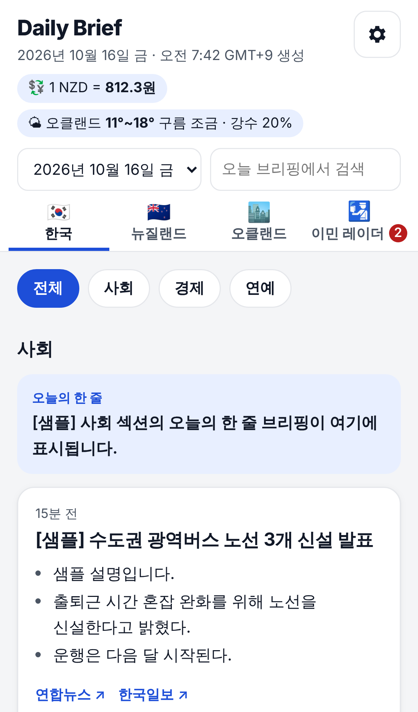
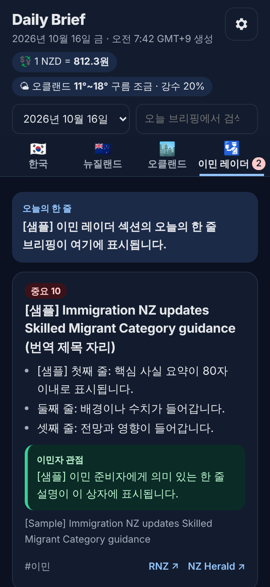
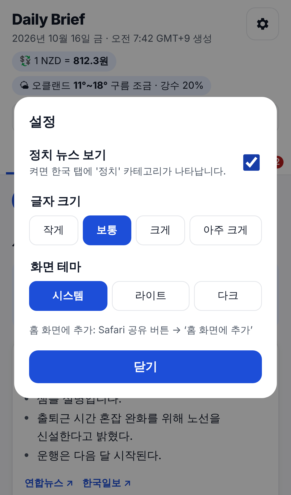
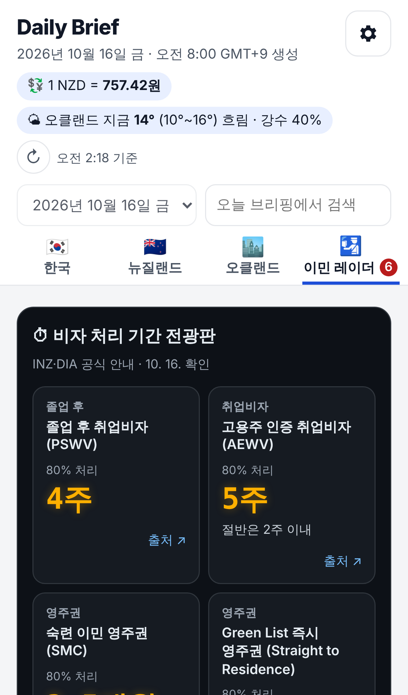

# Daily Brief — 한국 + 뉴질랜드 이민 준비자를 위한 아침 뉴스 요약

매일 아침 8시 전에 아래 섹션의 주요 뉴스를 AI(Google Gemini 무료 등급)가 한국어로 요약해 웹/모바일(PWA)로 보여줍니다.

| 탭 | 내용 |
|---|---|
| 🇰🇷 한국 | 사회 · 경제 · 연예 (정치는 설정에서 켰을 때만 표시) |
| 🇳🇿 뉴질랜드 | 사회 · 교육(초등·중간학교 중심) · 경제 · 정치 칩으로 나눈 **전국 단위** 뉴스 + "이민자 관점" 한 줄 |
| 🏙️ 오클랜드 | **오클랜드 지역** 뉴스를 생활·의료·교육(초등)·치안·부동산 칩으로 나눠 표시 + 생활비 지표·주제별 공식 안내 링크. 뉴질랜드 탭과 겹치지 않음 |
| 🛂 이민 레이더 | 독자 프로필(`config.yaml` 의 `profile`) 기준 이민 소식 — 졸업 후 취업비자·취업비자·영주권·시민권 중심. 여기 실린 기사는 다른 탭에 중복으로 나오지 않음 (탭에 건수 배지) |

서버 없이 **GitHub Actions(수집·요약) + GitHub Pages(정적 사이트) + Gemini API 무료 등급**으로만 동작하며, **운영 비용은 0원**입니다. 조건은 [요금 0원 유지하기](#요금-0원-유지하기)를 참고하세요.

<p>




</p>

<sub>스크린샷은 레이아웃 확인용 샘플 데이터([샘플] 표시, 환율·날씨 값 포함)로 찍었으며 실제 뉴스가 아닙니다.</sub>

---

## 동작 방식

```
cron-job.org 06:00 (NZ) → GitHub Actions  (보조: GitHub 예약 06:05 / 06:20 / 06:35)
  └─ scripts/main.py
       ├─ 시각 확인: config.yaml 의 timezone 기준 06~07시대가 아니거나 오늘 파일이 이미 있으면 종료
       ├─ fetch.py      RSS 수집 (최근 24시간, 피드당 30건, 피드별 실패 격리, 대체 피드 자동 시도)
       ├─ dedupe.py     URL 정규화 + 제목 유사도(rapidfuzz ≥ 85)로 같은 사건 묶기, 출처는 모두 보존
       ├─ rank.py       Gemini(flash-lite 계열)로 지역(한국/NZ)별 1회씩 중요도 1~10 채점 → 섹션별 상위 N건 (한국 5 / NZ 8 / 오클랜드 5)
       │                같은 사건 묶기(AI same_as + 제목 유사도), 오클랜드 지역 소식은 오클랜드 탭·전국 소식은 뉴질랜드 탭으로 재배치
       ├─ summarize.py  Gemini(flash)로 지역별 1회 호출: 한국어 제목, 3줄 요약, 이민자 관점, 태그, 섹션별 한 줄 브리핑
       ├─ extras.py     NZD/KRW 환율(frankfurter), 오클랜드 날씨(Open-Meteo)
       ├─ build.py      스키마 검증 → web/public/data/YYYY-MM-DD.json, latest.json, index.json / 30일 지난 파일 삭제
       └─ notify.py     (선택) Telegram / Gmail 알림
  └─ 데이터 커밋 → deploy.yml 로 Pages 배포
```

- **원문 전문은 저장하지 않습니다.** 상위 기사 본문 일부(최대 1,500자)를 요약 입력으로만 쓰고, 결과 JSON에는 요약과 원문 링크만 남깁니다.
- AI 응답은 JSON 스키마로 강제합니다(Gemini `responseSchema`). 형식이 깨지면 해당 부분만 원문 정보로 대체합니다.
- 피드 하나가 실패하거나 AI 호출이 실패해도(무료 한도 초과 포함) 나머지는 계속 진행합니다. AI 가 실패한 부분은 키워드 선별 + RSS 원문 설명으로 대신 표시합니다. 실패한 피드 목록은 JSON `meta.failed_feeds` 와 화면 하단에 표시됩니다.
- 기사가 0건이거나 스키마 검증에 실패하면 워크플로가 실패하고 **GitHub 이슈가 자동 생성**됩니다. 같은 제목의 열린 이슈가 있으면 댓글을 추가합니다.

## 처음 설정하기

### 1. 저장소 설정
1. **Settings → Pages → Build and deployment → Source: GitHub Actions** 를 선택합니다.
2. **Settings → Secrets and variables → Actions → New repository secret**:

   | 이름 | 필수 | 설명 |
   |---|---|---|
   | `GEMINI_API_KEY` | ✅ | Google AI Studio 에서 발급. **결제 연결 없이** 만드세요 (아래 참고) |
   | `ANTHROPIC_API_KEY` | 선택 | `llm.provider: anthropic` 으로 바꿔 Claude API 를 쓸 때만 (유료, 구독과 별도 청구) |
   | `TELEGRAM_BOT_TOKEN`, `TELEGRAM_CHAT_ID` | 선택 | 텔레그램 알림 (`notify.telegram.enabled: true` 필요) |
   | `SMTP_USER`, `SMTP_PASSWORD`, `EMAIL_TO` | 선택 | Gmail 알림. 비밀번호는 [앱 비밀번호](https://myaccount.google.com/apppasswords) 사용 |

   키는 코드나 `config.yaml` 에 절대 적지 마세요.
3. **Settings → Actions → General → Workflow permissions: Read and write permissions** 를 선택합니다. 데이터 커밋과 이슈 생성에 필요합니다.
4. 무료 GitHub Pages 를 쓰려면 저장소가 public 이어야 합니다.

### 2. 첫 실행
- `main` 브랜치에 병합한 뒤 **Actions → Check feeds → Run workflow** 로 피드 상태를 먼저 확인합니다. 죽은 피드는 `config.yaml` 에서 URL을 바꾸거나 `enabled: false` 로 끕니다.
- **Actions → Daily Brief → Run workflow** 로 수동 실행합니다. `force` 가 기본으로 켜져 있어 시각 조건 없이 바로 생성됩니다. 오늘 브리핑이 이미 있으면 AI 를 호출하지 않고 건너뛰며(중복 실행 방지), 다시 만들려면 `overwrite` 를 켜세요. 끝나면 Pages 에 배포됩니다.
- 사이트 주소: `https://<계정>.github.io/<저장소>/` (예: https://dkwo284-max.github.io/News_Summary/)

> 예약 실행(`schedule`)은 GitHub 정책상 **기본 브랜치(main)** 에서만 동작합니다.

### 3. 홈 화면에 설치
- **iPhone (Safari)**: 공유 버튼 → "홈 화면에 추가"
- **Android (Chrome)**: 메뉴 → "앱 설치" 또는 "홈 화면에 추가"

한 번 열어 두면 오프라인에서도 마지막으로 받은 브리핑을 볼 수 있습니다.

## 실행 시각 / 타임존

- 기본값은 **뉴질랜드 시간(`Pacific/Auckland`) 매일 아침 06:00**입니다. cron-job.org 가 06:00 에 실행을 요청하고, 생성에 5~15분 걸려 7시 전에 사이트가 갱신됩니다.
- GitHub 자체 예약(06:05 / 06:20 / 06:35)은 보조입니다. 그날 브리핑이 없을 때만 생성하고, 이미 있으면 몇 초 만에 끝납니다. 06:00~07:59 사이에 시작된 실행만 생성해요.
- 뉴질랜드 서머타임(9월 말~4월 초, UTC+13)과 표준시(UTC+12)는 자동으로 처리합니다(cron-job.org 는 타임존 설정으로, GitHub 예약은 17시·18시 UTC 를 모두 걸어서).
- 시각을 바꾸려면 `config.yaml` 의 `run_hour`, cron-job.org 실행 시각, `daily.yml` 의 cron 을 함께 바꾸세요.

## 기사 제외 · 이민 레이더 맞춤 설정

- **제외 기사**: `config.yaml` 의 `exclude.title_keywords`(제목 키워드)와 `exclude.sources`(출처)에 걸리는 기사는 수집 직후 뺍니다. 개인 사연·모금, 부동산 매물·분양, 광고·협찬이 기본으로 들어 있어요. 키워드로 못 거른 기사는 AI 가 선별 단계에서 한 번 더 걸러냅니다(`junk`).
- **이민 레이더**: `profile.summary` 에 적힌 독자 상황을 기준으로 AI 가 기사마다 레이더 관련도(0~10)를 매기고, `radar_min_score`(기본 5) 이상만 관련도 순으로 싣습니다. 기본 프로필은 "UoA 석사 졸업 예정 학생비자 소지자"이고, 졸업 후 취업비자(PSWV)·AEWV·Green List·Skilled Migrant·영주권·시민권을 우선합니다. 신규 학생비자·관광비자·계절근로·타국 정책은 낮게 봅니다. 상황이 바뀌면(예: 취업비자 취득 후) `profile.summary` 만 고치면 됩니다.
- 레이더에 실린 기사는 뉴질랜드·오클랜드 탭에서 빠지고, 그 자리는 다음 순위 기사로 채워집니다. 뉴질랜드 탭의 "이민자 관점" 문구도 같은 프로필을 기준으로 씁니다.
- **총선 이민 공약**: 정당별 이민·취업비자·영주권 공약과 연정·새 정부의 이민 정책 방향은 레이더 관련도 7~9로 봅니다. 전용 피드 `gn_nz_election_immigration` 이 이틀치 관련 기사를 따로 모읍니다.

## 이민 알림 · 내 비자 일정

- **🚨 이민 알림**: 처리 기간이 약 1주 전보다 크게 바뀌거나(7일 이상이면서 10% 이상), 레이더 관련도가 `profile.alert_radar_score`(기본 9) 이상인 기사가 있으면 이민 레이더 탭 맨 위에 띄웁니다. 텔레그램·메일 알림을 켜 두면 메시지 첫머리에도 들어갑니다.
- **처리 기간 추세**: 날마다 값을 `web/public/data/processing-history.json` 에 쌓고, 전광판 칸마다 1주 전 대비 ▲/▼ 일수를 보여줍니다.
- **📅 내 비자 일정 (D-day)**: 설정(⚙️) → "내 비자 일정"에 가족별 비자 종류·만료일과 자녀 생일을 넣으면, 이민 레이더 탭에 만료 D-day와 할 일(졸업 후 취업비자 준비, 가족 비자 준비, 다음 비자 신청 권장일, 자녀 초등학교 입학)을 날짜순으로 보여줍니다. 상단에도 가장 가까운 D-day 가 표시돼요. **이 정보는 이 기기(브라우저)에만 저장되고 저장소·서버로 보내지 않습니다.** `#setup=<base64url JSON>` 링크로 한 번에 입력할 수도 있습니다.

## 오클랜드 탭: 생활·치안·부동산·의료·교육 + 📍 내 동네

- 오클랜드 기사는 한 묶음(`nz_auckland`)으로 선별한 뒤 AI 가 주제(`akl_topic`)를 붙여 `akl_life`·`akl_safety`·`akl_property`·`akl_health`·`akl_education` 섹션으로 나눕니다. AI 없이 돌 때는 `config.yaml` 의 `akl_topics` 키워드로 나눕니다.
- 주제별 보강 피드(`gn_akl_health`·`gn_akl_school`·`gn_akl_crime`·`gn_akl_property`)가 기사를 따로 모아, 큰 뉴스에 밀려 빠지지 않게 합니다.
- 그날 새 소식이 없는 주제는 `carry_days`(의료·교육·부동산 3일, 치안 2일) 안의 최근 기사를 **'지난 소식'** 표시와 함께 보여줍니다.
- 의료·교육·치안·부동산 칩에는 응급 111·Healthline·GP 찾기, 학군 찾기·ERO 보고서, 105 신고·동네별 범죄 통계, 시세 렌트·QV 집값·GeoMaps(침수·용도지역) 같은 공식 창구 링크가 함께 나옵니다.

### 📍 내 동네 (관심 동네·학교 비교)

- 설정(⚙️) → "관심 동네·학교"에 동네(최대 6곳)와 학교를 넣거나, `#areas=Milford,Takapuna&schools=Milford School` 링크로 한 번에 입력합니다. **이 기기에만 저장되고 저장소·서버에는 올라가지 않습니다.**
- 비교표: 동네별 주택 3·4룸, 아파트 2룸 주간 렌트 중간값(Tenancy Services 시세 렌트, 최근 6개월 보증금 신고 기준)과 QV 평균 집값(옛 시 단위 — 예: North Shore City).
- 동네 카드: 방 수별 렌트와 원화 환산, 최근 2주 브리핑에서 그 동네가 나온 기사(치안 건수 따로), UoA 대중교통 경로·범죄 통계·침수/용도지역·한인마트·근처 GP 바로가기.
- 학교 카드: 자녀 생년월일(비자 일정 설정)로 계산한 입학·학군 준비 시점, 최근 2주 관련 기사, 학군·ERO 보고서·학생 수 검색 바로가기.
- 데이터는 `scripts/areas.py` 가 매주(`areas.refresh_days`) `web/public/data/areas.json` 으로 받습니다. 지원 동네 목록은 `config.yaml` 의 `areas.suburbs`.
- 학교 목록·동네별 범죄 통계는 공식 사이트가 자동 수집을 막아(Cloudflare·Tableau) 바로가기로 대신합니다.

### 🇰🇷 한인 GP 지도

- 오클랜드 탭 **의료** 칩에 한인 GP 지도와 목록이 나옵니다(초록 = 등록 가능, 주황 = 조건부·일부, 회색 = 마감). "등록 가능만" 버튼으로 거를 수 있고, 관심 동네가 있으면 가까운 순으로 정렬하고 거리를 보여줍니다.
- **📍 내 동네** 카드마다 가장 가까운 한인 GP 2곳(전화 연결)과 지도 바로가기가 붙습니다.
- 목록 출처는 [한인.nz 뉴질랜드 한인 GP 목록](https://hanin.nz/korean-gp)이며 매일 아침 `scripts/korean_gp.py` 가 받아 `web/public/data/korean-gp.json` 에 저장합니다. 좌표는 OpenStreetMap Nominatim 으로 한 번만 찾아 파일에 캐시합니다(초당 1회 제한 준수). 지도 타일 © OpenStreetMap.
- 의사 이동·등록 가능 여부는 수시로 바뀌므로, 방문 전 병원에 전화로 확인하세요.

## 🆕 매일 보기 편의 기능

- **오늘 한눈에**: 각 탭 위에 새 소식·지난/반복·영향 높음·팔로우 업데이트 수와 새 소식 비율 막대.
- **🆕 새 소식만 보기**: 최근 3일 브리핑에 이미 나온 기사, 제목 핵심어가 크게 겹치는 반복 기사, '지난 소식'을 숨깁니다(후속 보도로 '달라진 점'이 있는 기사는 남김). 설정은 이 기기에만 저장, AI 없음.
- **📌 이슈 팔로우**: 기사 카드의 "팔로우" → 이후 브리핑에서 같은 기사·그 기사가 흐름에 있는 후속 보도·제목 핵심어 3개 이상 겹치는 기사를 탭 위 "팔로우 중인 이슈"에 모아 보여줍니다(이 기기에만 저장).
- **🧭 이민 단계 트래커**(이민 레이더 탭): 학생 → PSWV → 취업 → 영주권 → 영구 → 시민권 단계 표시, 단계별 현재 처리 기간, 내 비자 만료일 기준 권장 신청 시점(만료 − 처리 기간 − 1개월), 다음 단계 관련 최근 2주 기사.
- **AI 실패 자동 복구**: 요약·선별이 Gemini 오류로 실패하면 브리핑에 `meta.degraded` 를 남기고, 화면에 안내를 띄운 뒤 오클랜드 10:10·14:10(표준시 09:10·13:10) 예약 실행이 다시 생성합니다(하루 최대 2번, 실패한 날만 AI 사용).
- 카드 왼쪽 색 띠: 내게 미치는 영향 높음(빨강)·보통(주황)·낮음(회색).

- **교육 기사 수집 확대**: 구글 뉴스 검색 피드를 정책·교육과정, 교사·노조·인력, 급식·출결·안전·시설·학습지원, 교육 전문 매체(Education Central·RNZ 교육), 영어 지원·다양성·특수교육, 대학·유학생, 오클랜드 지역 학교(노스쇼어·동·서·남), 학교 신설·통폐합·학군, 학교 안전·통학으로 나눠 추가했습니다. 교육 섹션은 뉴질랜드·오클랜드 각 6건까지(오클랜드는 새 소식이 없으면 최근 5일 기사로 채움), 후보 풀도 넓혔습니다.
- **🎓 대학·유학생은 기본 숨김**: 교육 칩의 "🎓 대학·유학생 보기" 버튼을 켜면 보이고(이 기기에 저장) 주제 칩에도 나타납니다.
- **교육 주제 필터**: 교육 칩(뉴질랜드·오클랜드)에서 기사를 🛡️안전·징계 / 🏫학군·입학 / 👩‍🏫교사·인력 / 🍎급식·시설·복지 / 📘정책·교육과정 / 🎓대학·유학생으로 나눠 주제 칩(건수)·비율 막대·카드 배지로 보여줍니다. 제목·요약·태그의 키워드 규칙으로 분류하며(`news-tools.ts` 의 `EDU_TOPICS`) AI 를 쓰지 않습니다.

## 🎯 내게 미치는 영향 · 🧵 이 이슈의 흐름

- **내게 미치는 영향**: 뉴질랜드·오클랜드·이민 레이더 기사 전부에 독자 프로필(`profile.summary`) 기준 영향도(높음/보통/낮음/없음), 이유, 할 일 0~2개, 지켜볼 신호(시행일·발표 예정 등)를 붙입니다. 영향이 거의 없는 기사는 한 줄로 접힙니다.
- **이 이슈의 흐름**: 지난 30일 브리핑에서 제목 핵심 단어가 겹치는 기사를 후보로 고르고, AI 가 같은 이슈인지 확인하면서 "달라진 점"을 한 줄로 씁니다. 확인된 지난 기사의 흐름까지 이어 붙여, 이슈가 길어질수록 타임라인이 자랍니다(한국 기사도 흐름만 표시).
- 두 가지를 한 요청에 묶어 `insight.batch_size`(60)건씩 보냅니다(보통 AI 요청 1회). 실패해도 브리핑은 그대로 생성됩니다. 설정은 `config.yaml` 의 `insight`.

### 🗺️ 치안 지도 (오클랜드 → 치안)

- **사건 지도**: 오클랜드 기사에서 AI 가 사건 위치와 등급을 뽑아(인사이트 요청 안에서, 추가 요청 없음) 지난 90일치를 `web/public/data/incidents.json` 에 쌓고 지도에 표시합니다. 같은 장소는 원이 커지고, 누르면 날짜별 기사가 나옵니다. 7·30·90일, "1급만" 필터.
  - **1급** 살인·흉기·총기·성범죄·납치·**마약**(제조·밀수·거래·대량 압수) / **2급** 강도·폭행·램레이드·차량 탈취·방화 / **3급** 절도·파손·사기 / **사고** 교통사고·화재·실종
  - 처음 한 번은 지난 30일 브리핑의 오클랜드 사건 기사로 채웁니다(AI 요청 1회). 좌표는 Nominatim, 캐시.
- **동네별 위험 요약**: 관심 동네 반경 2km 의 최근 30일 보도 점수(1급 5·2급 3·3급 1)를 자주 찾는 동네 평균과 비교하고, 보도가 많았던 동네 Top 5(이전 30일 대비 ▲▼)를 보여줍니다.
- **알림**: 관심 동네 반경 2km 안에서 최근 7일 1급 사건이 보도되면 오클랜드 탭 맨 위에 🚨 배너.
- **경찰 공식 통계**: 뉴스는 보도된 사건만이라 실제 빈도와 다릅니다. 분기마다 policedata.nz CSV 를 `data/police/` 에 올리면(방법: `data/police/README.md`) 동네별 12개월 피해 건수·전년 대비·주요 범죄 종류가 표시됩니다.

## 💵 환율·비트코인 · 🏦 기준금리 비교

- 상단에 **1 NZD·1 USD·100 JPY 원화 환율**과 **1 BTC 달러 가격**을 나란히 보여줍니다(Coinbase 실시간, 환율은 실패 시 ECB 고시). ↻ 버튼으로 세 값을 함께 새로고침합니다.
- **뉴질랜드 → 경제** 칩 맨 위에 뉴질랜드(OCR)·한국(기준금리)·미국(연방기금 목표 범위) 기준금리 비교표: 현재 값, 최근 변경(bp·날짜), 1년 전 대비, 금리 차. 출처 BIS 중앙은행 정책금리(약 1주 늦게 반영), 미국은 FRED 목표 범위. `scripts/rates.py`.

### 🌏 지역별 민족 구성 지도 (오클랜드 → 부동산 칩)

- 2023 인구총조사(Stats NZ)의 **거주자 민족 구성**입니다. 범죄 자료가 아니라 인구 분포이며, 사건 지도·경찰 통계와 따로 표시됩니다. 한 사람이 여러 민족을 답할 수 있어(복수 응답) 비율의 합이 100%를 넘을 수 있고, 통계청이 소수 값을 무작위 반올림합니다.
- **동네 지도(SA2 640곳, 상세 3단계)**: 칩으로 분류를 바꿔 색칠합니다.
  - 아시아: 아시아계 전체(한국·일본·중국·동남아·인도 등 모두 포함) · **한국인 · 중국인 · 일본인** · 동남아인 · 인도·스리랑카계
  - 중동·남미·아프리카: **중동계(아랍·이란 등, 아시아계에 넣지 않음)** · 남미(라틴아메리카)계 · 아프리카계
  - 유럽: 유럽계 전체 · 뉴질랜드 유럽계 · 영국·아일랜드계 · 그 외 유럽계
  - 태평양계 · 마오리
  - **보기 방식 전환**: `동네 주민 중 비율`(밀집도: 그 동네 100명 중 몇 명) ↔ `이 분류 전체 중 비중`(분포: 오클랜드 전체 한국인 27,309명을 100%로 두고 동네별 몫, 모든 동네 합 100%). 지도 색·범례·표·툴팁이 함께 바뀝니다.
  - 지도는 크게(화면 높이의 약 2/3) 보여주고, 동네를 누르면 팝업 대신 **옆(모바일은 아래) 상세 패널**에 나옵니다. `⤢ 지도 크게` 버튼으로 더 키울 수 있어요.
  - 동네를 누르면 선택한 분류를 쉬운 말("주민 100명 중 약 8.4명, 오클랜드 평균 약 1.6명")·**평균 대비 배수**·**인원수**·**순위**로 먼저 보여주고, 그 아래 15개 분류 비율과 2018년 대비 변화(▲▼ %p)가 나옵니다.
  - **TOP 10 순위 막대**(관심 동네는 📍, 10위 밖이면 순위와 함께 덧붙임, 누르면 지도 이동), "동네 찾기", 관심 동네 파란 테두리, 비교표(배수·인원수 병기, 분류를 누르면 지도 변경).
- **출신별 세부(지역위원회 21곳, 상세 4단계)**: 동네 단위로는 공개되지 않는 세부 출신을 지역위원회별 순위 막대로 봅니다 — 미국인·캐나다인·영국·독일·러시아 등, 아랍·이란·터키·이스라엘 등, 브라질·멕시코·아르헨티나 등, 아프리카 주요국, 대만·필리핀·베트남·태국·네팔 등.
- 데이터: `scripts/census.py`(동네 경계·큰 분류, 키 불필요) + `scripts/census_detail.py`(상세 분류, Stats NZ API 무료 구독 키 필요 → Secret `STATSNZ_API_KEY`) → `web/public/data/census-akl.json`, `census-akl-detail.json`. 인구총조사는 5년마다라 **Actions → Census ethnic map data**(수동)로 필요할 때만 갱신합니다.

### 🏌️ 레저 (오클랜드 → 레저 칩)

골프장(오클랜드 전역)·요트 클럽/정박·카약·낚시를 **지도 한 장**에 보여줍니다.

- **지도**: 시설 종류별 색 점(골프는 성인 연회비 구간별 초록·주황·빨강·회색), 종류 필터, 내 동네 기준 거리·반경(5/10/20km) 원. 점을 누르면 옆(모바일은 아래) **상세 패널**에 전체 요금·가입 상태·적용 시즌·확인일·요금 원문 인용·공식 링크·평점 입력이 열립니다.
- **골프는 지도 + 회원권 비교표**: 클럽·거리(기본 기준은 시내 CBD, 내 동네로 바꿀 수 있음)·성인 1인 연회비·입회비·🌐 공식 사이트 링크. 커플·가족 연회비와 평점은 클럽을 눌렀을 때 패널과 "가입 비용 비교"에서 봅니다. 이름을 누르면 지도가 그 클럽으로 이동하고 **회원 vs 방문자 손익분기 계산**(연 라운드 수·입회비 분할)이 패널에 열립니다. 원화 환산 옵션.
- **🧸 키즈카페·가족 시설 / 🏊 수영·워터**: 실내 놀이터·키즈카페·트램폴린·동물원·박물관·수족관, 시의회 수영장(알바니·타카푸나·글렌필드)·온천 풀을 같은 방식(지도 점 → 패널, 어린이·가족권 요금)으로 보여줍니다. 비 오는 날은 키즈 시설, 더운 날은 야외 수영을 추천하는 날씨 점수도 있습니다. 자동 수집값이 엉뚱한 시설(수영장 페이지의 헬스장 요금 등)은 `leisure-manual.json` 의 `replace_fees` 로 직접 넣은 값만 씁니다.
- **🥋 어린이 스포츠·태권도 / 🚶 걷기·자전거 코스**: 노스쇼어 태권도장(글렌필드 Jungshin, 브라운스베이 Sejong, 타카푸나 Tamaki)과 유소년 축구·럭비 클럽의 등록 요금, 유모차·자전거로 갈 수 있는 해안 코스(Tāmaki Drive·데본포트~타카푸나·타카푸나~밀포드·North Shore Coastal Walk·Tāmaki Path)를 보여줍니다. 요금이 없는 코스는 AI 로 읽지 않습니다(`no_fees`).
- **🛝 놀이터·💦 스플래시 레이어**: OpenStreetMap 의 이름 있는 놀이터와 물놀이 놀이터를 지도에 켜고 끌 수 있습니다(장소 데이터와 같은 `spots.json`).
- **요트·카약·낚시는 지도에서 누르는 방식**(접힌 목록도 있음). 낚시 규칙 요약과 공식 링크 포함.
- **장소(spot) 레이어**: ⚓ 보트 램프(카약·보트 출발) · 🎣 부두·낚시 포인트 · 🏖️ 해변을 켜고 끌 수 있습니다(OpenStreetMap, `scripts/spots.py`, 워크플로 `Fishing / kayak / swim spots` — 1년에 한 번 또는 수동, AI 없음). 해변은 Safeswim, 낚시 장소는 낚시 규칙·해상 예보 링크.
- **💰 가입 비용 비교**: 성인 1인·커플·가족 × 1/3/5/10년 총액(연회비 × 기간 + 입회비 1회)을 낮은 순으로. 대기 명단 같은 상태와 최근 변경 표시.
- **🔔 변경 알림**: 요금이나 가입 상태(예: 대기 명단 열림)가 바뀌면 `leisure.json` 의 `changes` 에 기록해 화면 상단에 보여주고, 설정(`notify`)에서 텔레그램·이메일을 켰다면 알림도 보냅니다.
- **오늘·내일 가기 좋은가**: Open-Meteo(키 없음) 예보로 8~18시 바람·돌풍·강수확률·파고를 활동별 🟢🟡🔴 점수로. 이 기기에 30분 동안 저장해 다시 씁니다.

**AI 사용량 최적화 (이후 실행)**

- 요금은 거의 안 바뀌므로 매일 도는 파이프라인에는 없고, `Leisure fees` 워크플로가 **한 달에 한 번** 공식 페이지를 받아 오기만 합니다(AI 없음).
- 받은 페이지 글의 **지문(hash)이 이전과 같으면 AI 를 부르지 않습니다**(확인일만 갱신). **바뀐 시설만** 모아서 시설 3곳당 AI 1회로 읽고, 금액이 페이지 글에 실제로 있는지 검증합니다. 보통 달에는 **AI 0회**입니다. 예산이 모자라면 미루고 다음 실행에서 이어서 읽습니다.
- 읽었는데 요금이 없던 페이지도 지문을 남겨 같은 글을 또 읽지 않고, 읽지 못한 페이지(404·403·로그인)는 AI 를 쓰지 않습니다. 처음 한 번은 Actions → Leisure fees 에서 `seed_hashes` 를 켜 이미 읽은 값의 지문만 기록할 수 있습니다(AI 없음).
- 장소·매장 위치는 AI 없이 1년에 한 번, 날씨는 브라우저에서 바로 계산합니다.
- 평점은 구글 약관·결제 문제로 자동 수집하지 않습니다. `data/leisure-manual.json` 에 적거나 화면에서 "이 기기에 저장"으로 입력하세요(9개월 넘으면 "오래됨"). 같은 파일에 직접 확인한 요금·메모·숨김도 적을 수 있고 수집값보다 우선합니다.
- **시설 추가**: `data/leisure-src.json` 에 한 줄(id·kind·name·geo·home·pages)을 더하고 Actions → Leisure fees 를 실행하세요(`only` 에 id 를 넣으면 그 시설만).
- 한계: 클럽은 입회 심사·대기 명단이 있고 일부는 요금을 비공개로 둡니다. 동적 페이지·접속 차단 사이트는 요금을 못 읽어 "미확인"으로 표시됩니다. 수영장·레저센터는 아직 목록에 없습니다.

## 오클랜드 생활비 지표

오클랜드 탭 **부동산** 칩에서 매일 아침 정부 공개 데이터를 보여줍니다(키·요금 없음, AI 요청 없음).

- 주간 렌트 중간값·사분위 범위·전년 대비: Tenancy Services 렌트 보증금 데이터(TLA 월간 CSV, 신규 임대차 기준, 보통 1~2달 늦게 공개)
- 휘발유 91·경유 리터당 가격과 전주 대비: MBIE 주간 유가 모니터링(전국 평균 게시 가격)
- 원화는 현재 환율로 어림합니다. 지역은 `config.yaml` 의 `costs.rent_location` 으로 바꿀 수 있어요(기본 Auckland).

## 환율·날씨 실시간 새로고침 · 비자 처리 기간 전광판

- 상단 환율·날씨 옆 **↻ 버튼**을 누르면 브라우저가 Coinbase(환율, 분 단위 갱신)와 Open-Meteo(날씨, 현재 기온 포함)에서 최신 값을 바로 받아옵니다. Coinbase 가 안 되면 frankfurter(유럽중앙은행 고시 환율, 평일 하루 1회 갱신)를 씁니다. 어느 소스인지 버튼 옆에 표시돼요. 키가 필요 없고 요금도 없습니다. 마지막 값은 6시간 동안 기기에 저장돼, 다시 열어도 유지됩니다.
- **🛂 이민 레이더 탭 위의 전광판**은 매일 아침 브리핑을 만들 때 공식 페이지에서 처리 기간을 가져옵니다.
  - 영주권(SMC·Green List Straight to Residence·Work to Residence·Permanent Resident): INZ *Resident visa wait times* 표. 평균(50%)과 대부분(80%) 처리 기간을 모두 보여줍니다.
  - 취업비자(AEWV)·졸업 후 취업비자(PSWV): INZ *Work visa wait times* 표 또는 비자 안내 페이지의 "Processing time 80% within …"
  - 시민권: DIA *Application timeframes* ("within 6 months … 90% of applicants are granted citizenship")
  - 페이지 형식이 바뀌어 읽지 못하면 AI 가 본문에서 한 번 더 추출하고, 그래도 안 되면 이전 값을 "MM/DD 기준" 표시와 함께 보여줍니다. 항목·주소는 `config.yaml` 의 `processing_times` 에서 바꿉니다. **Actions → Check processing times** 로 지금 바로 점검할 수 있어요(결과는 `processing-check` 브랜치).

## 매일 06:00 정확히 실행하기 (cron-job.org)

GitHub 예약 실행(schedule)은 부하가 크면 누락될 수 있어서, 외부 무료 예약 서비스가 매일 06:00(NZ)에 실행 요청을 보내게 합니다. GitHub 예약은 보조로 그대로 둡니다. 이미 그날 브리핑이 있으면 실행은 몇 초 만에 끝나므로 둘 다 돌아도 문제없어요.

1. **GitHub 토큰**: Settings → Developer settings → Personal access tokens → Fine-grained tokens → Generate new token
   - Repository access: *Only select repositories* → `News_Summary`
   - Repository permissions → **Actions: Read and write** (나머지는 그대로)
2. **cron-job.org** → Create cronjob
   - URL: `https://api.github.com/repos/dkwo284-max/News_Summary/actions/workflows/daily.yml/dispatches`
   - 실행 시각: 매일 06:00, 타임존 `Pacific/Auckland`
   - Advanced → Request method `POST`, 헤더 `Accept: application/vnd.github+json`, `Authorization: Bearer <토큰>`, `X-GitHub-Api-Version: 2022-11-28`, `Content-Type: application/json`
   - Request body: `{"ref":"main","inputs":{"force":"false","processing_only":"false"}}`
   - Test run 결과가 **204** 면 성공 (Actions 탭에 Daily Brief 실행이 생김)

## 피드 추가·삭제

`config.yaml` 의 `feeds:` 목록을 고칩니다.

```yaml
  - id: hankyung_economy          # 고유 이름 (영문)
    name: "한국경제"               # 카드에 표시될 출처명
    section: kr_economy           # kr_society | kr_economy | kr_entertainment | kr_politics | nz_national | nz_auckland | nz_immigration
    url: "https://www.hankyung.com/feed/economy"
    fallbacks: []                 # 기본 URL 이 죽었거나 0건일 때 순서대로 시도할 대체 피드
    enabled: true
    google_news: false            # Google News RSS 면 true ("제목 - 언론사"를 분리해 실제 언론사명을 출처로 사용)
```

- 공식 RSS 가 없는 사이트는 Google News 검색 RSS 로 대체할 수 있습니다:
  `https://news.google.com/rss/search?q=site:example.com+when:1d&hl=en-NZ&gl=NZ&ceid=NZ:en`
- 추가한 뒤 `python scripts/check_feeds.py` 또는 **Check feeds** 워크플로로 확인하세요.
- 섹션별 건수(`top_n`), 뉴질랜드 가중치 키워드(`weights`), 모델(`llm`)도 같은 파일에서 바꿉니다.

## 로컬 실행

```bash
python3.12 -m venv .venv && source .venv/bin/activate
pip install -r requirements-dev.txt

pytest                                         # 파서·중복제거·스키마·게이트 테스트 (네트워크/API 불필요)

# 네트워크·API 없이 샘플 피드로 전체 파이프라인 확인
python scripts/main.py --dry-run --no-llm --fixtures tests/fixtures/feeds --now 2026-10-15T22:00:00Z

# 실제 피드 + Gemini 요약, 결과는 out/dry-run/ 에만 저장 (알림·정리 안 함). 무료 한도에서 요청 5회 사용
export GEMINI_API_KEY=...
python scripts/main.py --dry-run

# 프론트엔드
cd web && npm install && npm run dev           # http://localhost:5173 (web/public/data 의 JSON 사용)
```

`--dry-run` 결과를 화면에서 보려면 `out/dry-run/*.json` 을 `web/public/data/` 로 복사한 뒤 `npm run dev` 를 실행하세요.

| 옵션 | 설명 |
|---|---|
| `--force` | 시각 조건·중복 실행 검사를 무시 |
| `--skip-existing` | `--force` 여도 오늘 브리핑이 이미 있으면 AI 호출 없이 종료 (Actions 수동 실행의 기본값, `overwrite` 로 해제) |
| `--dry-run` | `out/dry-run/` 에만 저장, 알림·오래된 파일 정리 안 함 |
| `--no-llm` | AI 호출 없이 키워드 점수 + RSS 설명으로 실행 (요약·번역 없음, 점검용) |
| `--fixtures DIR` | 피드를 `DIR/<feed_id>.xml` 에서 읽음 |
| `--no-extras` | 환율·날씨 조회 생략 |

## 요금 0원 유지하기

AI 요약은 **Google Gemini API 무료 등급**을 씁니다. 다음만 지키면 요금이 나오지 않습니다.

1. https://aistudio.google.com/apikey 에서 **Create API key** 를 눌러 키를 만듭니다. 새 프로젝트로 만들어도 됩니다.
2. 그 키가 속한 Google Cloud 프로젝트에 **결제(Billing) 계정이나 카드를 연결하지 마세요.** AI Studio 에서 "Set up billing", "Upgrade" 를 누르지 않으면 됩니다.
   - 결제가 연결되지 않은 키는 무료 등급으로만 동작합니다. 한도를 넘으면 **요금이 붙는 대신 요청이 거절(429)**됩니다.
   - 결제를 연결하면 유료 등급으로 바뀌어 사용량만큼 청구됩니다.
3. 키를 GitHub Secret `GEMINI_API_KEY` 로 등록합니다.

요청 수 제한
- 하루 1회 실행에 보내는 AI 요청은 보통 **4회**입니다(한국+NZ 통합 선별 1회 + 요약 지역별 2회 + 인사이트 1회). 같은 이슈 묶기는 선별 호출의 `same_as`(+제목 핵심어 겹침)로 처리해 별도 호출이 없습니다. `llm.max_requests_per_run`(기본 7)을 넘지 않습니다.
- 예전 방식으로 되돌리려면 `config.yaml` 의 `llm.combined_rank: false`(지역별 선별 2회), `llm.regroup_call: true`(이슈 묶기 호출 +1회)로 바꾸세요.
- 분당 한도를 넘지 않도록 요청 사이에 10초 간격을 둡니다(`min_interval_seconds`).
- 무료 등급 한도(분당·일일 요청 수)는 모델마다 다르고 Google 이 자주 바꿉니다. AI Studio 의 Rate limit 화면에서 확인하세요. 한도에 걸리면 그날은 AI 없이 원문 정보로 표시되고, 다음 날 자동으로 회복됩니다.
- 수동 실행(Run workflow)도 한 번에 4~5회 정도를 씁니다.

알아둘 점
- 무료 등급에서는 보낸 내용(공개 뉴스 기사 제목·발췌)이 Google 서비스 개선에 쓰일 수 있습니다.
- 모델은 `config.yaml` 의 `llm.gemini` 에서 바꿉니다. 후보 목록을 앞에서부터 시도하고, 단종돼 404가 나면 다음 후보로 넘어갑니다(기본: `gemini-3.8-flash` 계열 → `gemini-flash-latest`). 모두 실패하면 AI Studio 에서 무료로 쓸 수 있는 모델명으로 바꾸세요.
- 실행 로그의 `usage provider=gemini requests=4/7 total cost=$0.0000` 줄에서 요청 수를 확인할 수 있습니다.

Claude API 로 바꾸고 싶다면 `llm.provider: "anthropic"` 으로 바꾸고 `ANTHROPIC_API_KEY` 를 등록하면 됩니다. 단, **Claude 구독(Pro/Max)과는 별도로** 사용량만큼 청구되며, 예상 비용은 하루 $0.15~0.25 입니다.

## 데이터 형식

`web/public/data/latest.json` (스키마: `schema/brief.schema.json`)

```jsonc
{
  "date": "2026-10-16",
  "generated_at": "2026-10-16T07:42:00+09:00",
  "timezone": "Asia/Seoul",
  "sections": {
    "nz_national": {
      "label": "뉴질랜드",
      "briefing": "오늘의 한 줄 브리핑",
      "items": [{
        "id": "3b8cf217f5d9",
        "title_ko": "한국어 제목",
        "summary_ko": ["줄1 (≤80자)", "줄2", "줄3"],
        "why_it_matters": "이민 준비자에게 의미 (NZ 섹션만)",
        "tags": ["비자", "주거"],
        "importance": 8,
        "sources": [{ "name": "RNZ", "url": "https://..." }],
        "original_title": "Original English title",
        "published_at": "2026-10-15T20:00+00:00"
      }]
    }
    // kr_society, kr_economy, kr_entertainment, kr_politics, nz_auckland, nz_immigration
  },
  "extras": {
    "nzd_krw": 812.3, "auckland_weather": { "max": 18, "min": 11, "desc": "구름 조금", "rain_chance": 20 },
    "processing_times": { "updated_at": "...", "items": [{ "key": "aewv", "p90": "5 weeks", "trend": { "since": "2026-10-14", "prev_p90": "4 weeks", "delta_days": 7 } }] },
    "living_costs": { "updated_at": "...", "rent": { "month": "2026-08", "median": 650, "lower": 550, "upper": 765, "yoy_pct": -1.5 },
                      "fuel": { "petrol91": { "date": "2026-10-16", "nzd_per_l": 3.62, "wow_cents": -3.5 }, "diesel": { } } }
  },
  "meta": { "mode": "gemini", "failed_feeds": [], "alerts": [{ "kind": "processing", "text": "...", "url": "..." }],
            "usage": { "provider": "gemini", "requests": 4, "total_cost_usd": 0.0 } }
}
```

## 디렉터리

```
.github/workflows/  daily.yml (수집·요약·커밋·배포) · deploy.yml (Pages) · ci.yml · check-feeds.yml
config.yaml         피드, 섹션별 건수, 타임존, 가중치, 모델, 알림
scripts/            main.py fetch.py dedupe.py rank.py summarize.py build.py llm.py extras.py processing.py costs.py notify.py check_feeds.py
schema/             brief.schema.json
tests/              pytest + 합성 샘플 피드(tests/fixtures)
web/                Vite + TypeScript PWA (index.html, src/, public/manifest.json, public/sw.js, public/icons/)
```

## 문제 해결

| 증상 | 확인 |
|---|---|
| 사이트가 갱신되지 않음 | Actions → Daily Brief 로그의 `skip:` 줄 (시각 조건 / 이미 생성됨) |
| 특정 언론사 기사가 안 나옴 | 화면 하단 "수집 실패한 피드", **Check feeds** 워크플로 |
| `GEMINI_API_KEY 가 없습니다` | Secrets 설정 확인 |
| 요약 없이 영어 원문/RSS 설명만 나옴 | Actions 로그의 `gemini HTTP ...` 줄: 400 API_KEY_INVALID = 키 오류, 429 = 무료 한도 초과(다음 날 자동 회복) |
| 데이터 커밋 push 실패 | Settings → Actions → Workflow permissions 가 Read and write 인지 확인 |
| 홈 화면 앱이 옛 화면을 보여줌 | 앱을 완전히 닫았다가 다시 열기 (서비스 워커가 다음 실행 때 갱신) |
