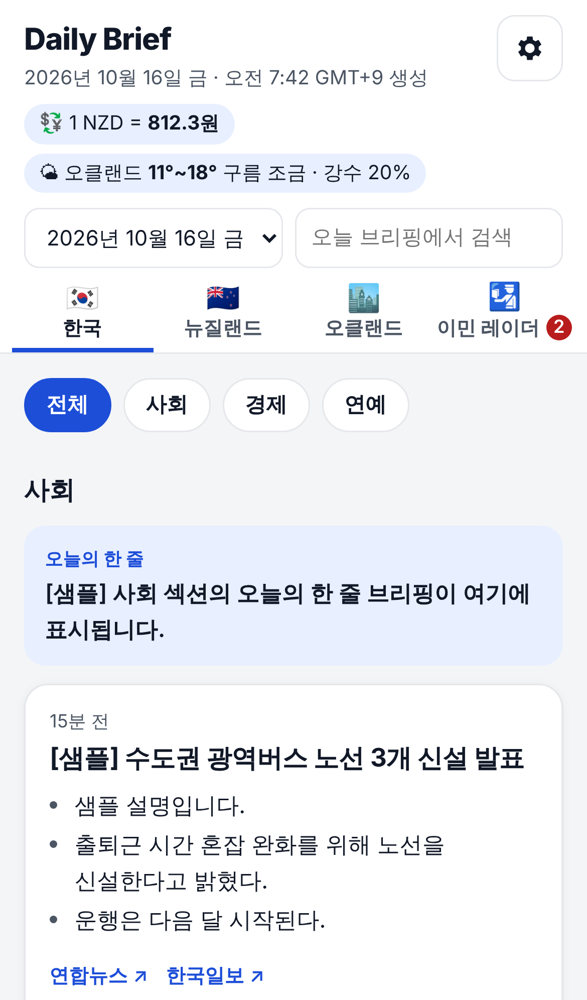
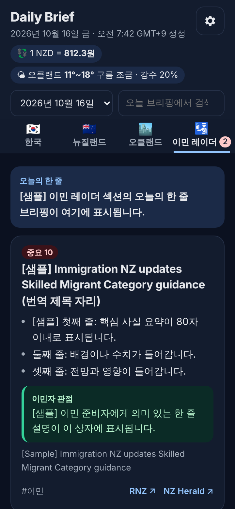
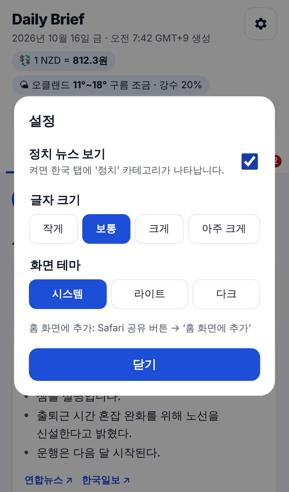
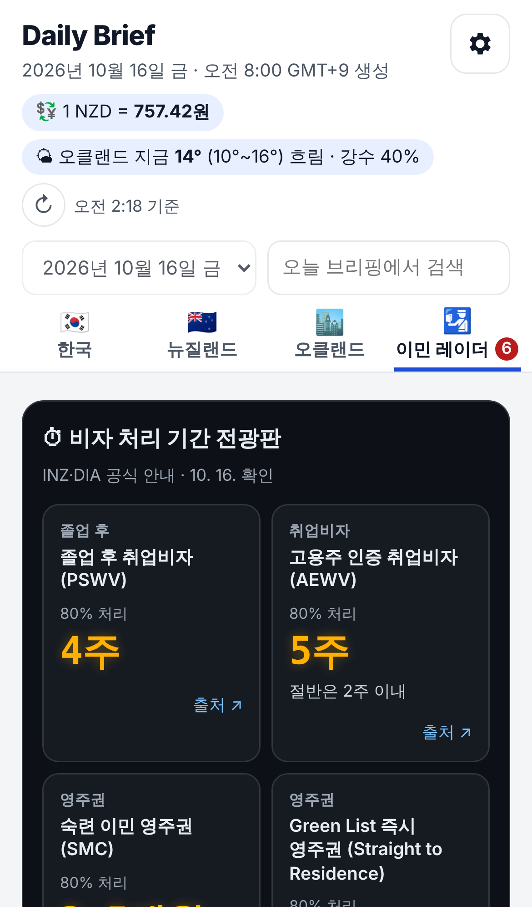

# Daily Brief — 한국 + 뉴질랜드 이민 준비자를 위한 아침 뉴스 요약

매일 아침 8시 전에 아래 섹션의 주요 뉴스를 AI(Google Gemini 무료 등급)가 한국어로 요약해 웹/모바일(PWA)로 보여줍니다.

| 탭 | 내용 |
|---|---|
| 🇰🇷 한국 | 사회 · 경제 · 연예 (정치는 설정에서 켰을 때만 표시) |
| 🇳🇿 뉴질랜드 | 사회 · 교육(초등·중간학교 중심) · 경제 · 정치 칩으로 나눈 **전국 단위** 뉴스 + "이민자 관점" 한 줄 |
| 🏙️ 오클랜드 | **오클랜드 지역** 뉴스 (시의회·교통·지역 사건사고·병원 등). 뉴질랜드 탭과 겹치지 않음 |
| 🛂 이민 레이더 | 독자 프로필(`config.yaml` 의 `profile`) 기준 이민 소식 — 졸업 후 취업비자·취업비자·영주권·시민권 중심. 여기 실린 기사는 다른 탭에 중복으로 나오지 않음 (탭에 건수 배지) |

서버 없이 **GitHub Actions(수집·요약) + GitHub Pages(정적 사이트) + Gemini API 무료 등급**으로만 동작하며, **운영 비용은 0원**입니다. 조건은 [요금 0원 유지하기](#요금-0원-유지하기)를 참고하세요.

<p>




</p>

<sub>스크린샷은 레이아웃 확인용 샘플 데이터([샘플] 표시, 환율·날씨 값 포함)로 찍었으며 실제 뉴스가 아닙니다.</sub>

---

## 동작 방식

```
cron-job.org 06:00 (NZ) → GitHub Actions  (보조: GitHub 예약 06:05 / 06:20 / 06:35)
  └─ scripts/main.py
       ├─ 시각 확인: config.yaml 의 timezone 기준 06~07시대가 아니거나 오늘 파일이 이미 있으면 종료
       ├─ fetch.py      RSS 수집 (최근 24시간, 피드당 30건, 피드별 실패 격리, 대체 피드 자동 시도)
       ├─ dedupe.py     URL 정규화 + 제목 유사도(rapidfuzz ≥ 85)로 같은 사건 묶기, 출처는 모두 보존
       ├─ rank.py       Gemini(flash-lite 계열)로 지역(한국/NZ)별 1회씩 중요도 1~10 채점 → 섹션별 상위 N건 (한국 5 / NZ 8 / 오클랜드 5)
       │                같은 사건 묶기(AI same_as + 제목 유사도), 오클랜드 지역 소식은 오클랜드 탭·전국 소식은 뉴질랜드 탭으로 재배치
       ├─ summarize.py  Gemini(flash)로 지역별 1회 호출: 한국어 제목, 3줄 요약, 이민자 관점, 태그, 섹션별 한 줄 브리핑
       ├─ extras.py     NZD/KRW 환율(frankfurter), 오클랜드 날씨(Open-Meteo)
       ├─ build.py      스키마 검증 → web/public/data/YYYY-MM-DD.json, latest.json, index.json / 30일 지난 파일 삭제
       └─ notify.py     (선택) Telegram / Gmail 알림
  └─ 데이터 커밋 → deploy.yml 로 Pages 배포
```

- **원문 전문은 저장하지 않습니다.** 상위 기사 본문 일부(최대 1,500자)를 요약 입력으로만 쓰고, 결과 JSON에는 요약과 원문 링크만 남깁니다.
- AI 응답은 JSON 스키마로 강제합니다(Gemini `responseSchema`). 형식이 깨지면 해당 부분만 원문 정보로 대체합니다.
- 피드 하나가 실패하거나 AI 호출이 실패해도(무료 한도 초과 포함) 나머지는 계속 진행합니다. AI 가 실패한 부분은 키워드 선별 + RSS 원문 설명으로 대신 표시합니다. 실패한 피드 목록은 JSON `meta.failed_feeds` 와 화면 하단에 표시됩니다.
- 기사가 0건이거나 스키마 검증에 실패하면 워크플로가 실패하고 **GitHub 이슈가 자동 생성**됩니다. 같은 제목의 열린 이슈가 있으면 댓글을 추가합니다.

## 처음 설정하기

### 1. 저장소 설정
1. **Settings → Pages → Build and deployment → Source: GitHub Actions** 를 선택합니다.
2. **Settings → Secrets and variables → Actions → New repository secret**:

   | 이름 | 필수 | 설명 |
   |---|---|---|
   | `GEMINI_API_KEY` | ✅ | Google AI Studio 에서 발급. **결제 연결 없이** 만드세요 (아래 참고) |
   | `ANTHROPIC_API_KEY` | 선택 | `llm.provider: anthropic` 으로 바꿔 Claude API 를 쓸 때만 (유료, 구독과 별도 청구) |
   | `TELEGRAM_BOT_TOKEN`, `TELEGRAM_CHAT_ID` | 선택 | 텔레그램 알림 (`notify.telegram.enabled: true` 필요) |
   | `SMTP_USER`, `SMTP_PASSWORD`, `EMAIL_TO` | 선택 | Gmail 알림. 비밀번호는 [앱 비밀번호](https://myaccount.google.com/apppasswords) 사용 |

   키는 코드나 `config.yaml` 에 절대 적지 마세요.
3. **Settings → Actions → General → Workflow permissions: Read and write permissions** 를 선택합니다. 데이터 커밋과 이슈 생성에 필요합니다.
4. 무료 GitHub Pages 를 쓰려면 저장소가 public 이어야 합니다.

### 2. 첫 실행
- `main` 브랜치에 병합한 뒤 **Actions → Check feeds → Run workflow** 로 피드 상태를 먼저 확인합니다. 죽은 피드는 `config.yaml` 에서 URL을 바꾸거나 `enabled: false` 로 끕니다.
- **Actions → Daily Brief → Run workflow** 로 수동 실행합니다. `force` 가 기본으로 켜져 있어 시각 조건 없이 바로 생성됩니다. 끝나면 Pages 에 배포됩니다.
- 사이트 주소: `https://<계정>.github.io/<저장소>/` (예: https://dkwo284-max.github.io/News_Summary/)

> 예약 실행(`schedule`)은 GitHub 정책상 **기본 브랜치(main)** 에서만 동작합니다.

### 3. 홈 화면에 설치
- **iPhone (Safari)**: 공유 버튼 → "홈 화면에 추가"
- **Android (Chrome)**: 메뉴 → "앱 설치" 또는 "홈 화면에 추가"

한 번 열어 두면 오프라인에서도 마지막으로 받은 브리핑을 볼 수 있습니다.

## 실행 시각 / 타임존

- 기본값은 **뉴질랜드 시간(`Pacific/Auckland`) 매일 아침 06:00**입니다. cron-job.org 가 06:00 에 실행을 요청하고, 생성에 5~15분 걸려 7시 전에 사이트가 갱신됩니다.
- GitHub 자체 예약(06:05 / 06:20 / 06:35)은 보조입니다. 그날 브리핑이 없을 때만 생성하고, 이미 있으면 몇 초 만에 끝납니다. 06:00~07:59 사이에 시작된 실행만 생성해요.
- 뉴질랜드 서머타임(9월 말~4월 초, UTC+13)과 표준시(UTC+12)는 자동으로 처리합니다(cron-job.org 는 타임존 설정으로, GitHub 예약은 17시·18시 UTC 를 모두 걸어서).
- 시각을 바꾸려면 `config.yaml` 의 `run_hour`, cron-job.org 실행 시각, `daily.yml` 의 cron 을 함께 바꾸세요.

## 기사 제외 · 이민 레이더 맞춤 설정

- **제외 기사**: `config.yaml` 의 `exclude.title_keywords`(제목 키워드)와 `exclude.sources`(출처)에 걸리는 기사는 수집 직후 뺍니다. 개인 사연·모금, 부동산 매물·분양, 광고·협찬이 기본으로 들어 있어요. 키워드로 못 거른 기사는 AI 가 선별 단계에서 한 번 더 걸러냅니다(`junk`).
- **이민 레이더**: `profile.summary` 에 적힌 독자 상황을 기준으로 AI 가 기사마다 레이더 관련도(0~10)를 매기고, `radar_min_score`(기본 5) 이상만 관련도 순으로 싣습니다. 기본 프로필은 "UoA 석사 졸업 예정 학생비자 소지자"이고, 졸업 후 취업비자(PSWV)·AEWV·Green List·Skilled Migrant·영주권·시민권을 우선합니다. 신규 학생비자·관광비자·계절근로·타국 정책은 낮게 봅니다. 상황이 바뀌면(예: 취업비자 취득 후) `profile.summary` 만 고치면 됩니다.
- 레이더에 실린 기사는 뉴질랜드·오클랜드 탭에서 빠지고, 그 자리는 다음 순위 기사로 채워집니다. 뉴질랜드 탭의 "이민자 관점" 문구도 같은 프로필을 기준으로 씁니다.

## 환율·날씨 실시간 새로고침 · 비자 처리 기간 전광판

- 상단 환율·날씨 옆 **↻ 버튼**을 누르면 브라우저가 Coinbase(환율, 분 단위 갱신)와 Open-Meteo(날씨, 현재 기온 포함)에서 최신 값을 바로 받아옵니다. Coinbase 가 안 되면 frankfurter(유럽중앙은행 고시 환율, 평일 하루 1회 갱신)를 씁니다. 어느 소스인지 버튼 옆에 표시돼요. 키가 필요 없고 요금도 없습니다. 마지막 값은 6시간 동안 기기에 저장돼, 다시 열어도 유지됩니다.
- **🛂 이민 레이더 탭 위의 전광판**은 매일 아침 브리핑을 만들 때 공식 페이지에서 처리 기간을 가져옵니다.
  - 영주권(SMC·Green List Straight to Residence·Work to Residence·Permanent Resident): INZ *Resident visa wait times* 표. 평균(50%)과 대부분(80%) 처리 기간을 모두 보여줍니다.
  - 취업비자(AEWV)·졸업 후 취업비자(PSWV): INZ *Work visa wait times* 표 또는 비자 안내 페이지의 "Processing time 80% within …"
  - 시민권: DIA *Application timeframes* ("within 6 months … 90% of applicants are granted citizenship")
  - 페이지 형식이 바뀌어 읽지 못하면 AI 가 본문에서 한 번 더 추출하고, 그래도 안 되면 이전 값을 "MM/DD 기준" 표시와 함께 보여줍니다. 항목·주소는 `config.yaml` 의 `processing_times` 에서 바꿉니다. **Actions → Check processing times** 로 지금 바로 점검할 수 있어요(결과는 `processing-check` 브랜치).

## 매일 06:00 정확히 실행하기 (cron-job.org)

GitHub 예약 실행(schedule)은 부하가 크면 누락될 수 있어서, 외부 무료 예약 서비스가 매일 06:00(NZ)에 실행 요청을 보내게 합니다. GitHub 예약은 보조로 그대로 둡니다. 이미 그날 브리핑이 있으면 실행은 몇 초 만에 끝나므로 둘 다 돌아도 문제없어요.

1. **GitHub 토큰**: Settings → Developer settings → Personal access tokens → Fine-grained tokens → Generate new token
   - Repository access: *Only select repositories* → `News_Summary`
   - Repository permissions → **Actions: Read and write** (나머지는 그대로)
2. **cron-job.org** → Create cronjob
   - URL: `https://api.github.com/repos/dkwo284-max/News_Summary/actions/workflows/daily.yml/dispatches`
   - 실행 시각: 매일 06:00, 타임존 `Pacific/Auckland`
   - Advanced → Request method `POST`, 헤더 `Accept: application/vnd.github+json`, `Authorization: Bearer <토큰>`, `X-GitHub-Api-Version: 2022-11-28`, `Content-Type: application/json`
   - Request body: `{"ref":"main","inputs":{"force":"false","processing_only":"false"}}`
   - Test run 결과가 **204** 면 성공 (Actions 탭에 Daily Brief 실행이 생김)

## 피드 추가·삭제

`config.yaml` 의 `feeds:` 목록을 고칩니다.

```yaml
  - id: hankyung_economy          # 고유 이름 (영문)
    name: "한국경제"               # 카드에 표시될 출처명
    section: kr_economy           # kr_society | kr_economy | kr_entertainment | kr_politics | nz_national | nz_auckland | nz_immigration
    url: "https://www.hankyung.com/feed/economy"
    fallbacks: []                 # 기본 URL 이 죽었거나 0건일 때 순서대로 시도할 대체 피드
    enabled: true
    google_news: false            # Google News RSS 면 true ("제목 - 언론사"를 분리해 실제 언론사명을 출처로 사용)
```

- 공식 RSS 가 없는 사이트는 Google News 검색 RSS 로 대체할 수 있습니다:
  `https://news.google.com/rss/search?q=site:example.com+when:1d&hl=en-NZ&gl=NZ&ceid=NZ:en`
- 추가한 뒤 `python scripts/check_feeds.py` 또는 **Check feeds** 워크플로로 확인하세요.
- 섹션별 건수(`top_n`), 뉴질랜드 가중치 키워드(`weights`), 모델(`llm`)도 같은 파일에서 바꿉니다.

## 로컬 실행

```bash
python3.12 -m venv .venv && source .venv/bin/activate
pip install -r requirements-dev.txt

pytest                                         # 파서·중복제거·스키마·게이트 테스트 (네트워크/API 불필요)

# 네트워크·API 없이 샘플 피드로 전체 파이프라인 확인
python scripts/main.py --dry-run --no-llm --fixtures tests/fixtures/feeds --now 2026-10-15T22:00:00Z

# 실제 피드 + Gemini 요약, 결과는 out/dry-run/ 에만 저장 (알림·정리 안 함). 무료 한도에서 요청 5회 사용
export GEMINI_API_KEY=...
python scripts/main.py --dry-run

# 프론트엔드
cd web && npm install && npm run dev           # http://localhost:5173 (web/public/data 의 JSON 사용)
```

`--dry-run` 결과를 화면에서 보려면 `out/dry-run/*.json` 을 `web/public/data/` 로 복사한 뒤 `npm run dev` 를 실행하세요.

| 옵션 | 설명 |
|---|---|
| `--force` | 시각 조건·중복 실행 검사를 무시 |
| `--dry-run` | `out/dry-run/` 에만 저장, 알림·오래된 파일 정리 안 함 |
| `--no-llm` | AI 호출 없이 키워드 점수 + RSS 설명으로 실행 (요약·번역 없음, 점검용) |
| `--fixtures DIR` | 피드를 `DIR/<feed_id>.xml` 에서 읽음 |
| `--no-extras` | 환율·날씨 조회 생략 |

## 요금 0원 유지하기

AI 요약은 **Google Gemini API 무료 등급**을 씁니다. 다음만 지키면 요금이 나오지 않습니다.

1. https://aistudio.google.com/apikey 에서 **Create API key** 를 눌러 키를 만듭니다. 새 프로젝트로 만들어도 됩니다.
2. 그 키가 속한 Google Cloud 프로젝트에 **결제(Billing) 계정이나 카드를 연결하지 마세요.** AI Studio 에서 "Set up billing", "Upgrade" 를 누르지 않으면 됩니다.
   - 결제가 연결되지 않은 키는 무료 등급으로만 동작합니다. 한도를 넘으면 **요금이 붙는 대신 요청이 거절(429)**됩니다.
   - 결제를 연결하면 유료 등급으로 바뀌어 사용량만큼 청구됩니다.
3. 키를 GitHub Secret `GEMINI_API_KEY` 로 등록합니다.

요청 수 제한
- 하루 1회 실행에 보내는 AI 요청은 보통 **5회**입니다(한국/NZ 선별 각 1회 + NZ 이슈 묶기 1회 + 요약 각 1회). `llm.max_requests_per_run`(기본 6)을 넘지 않습니다.
- 분당 한도를 넘지 않도록 요청 사이에 10초 간격을 둡니다(`min_interval_seconds`).
- 무료 등급 한도(분당·일일 요청 수)는 모델마다 다르고 Google 이 자주 바꿉니다. AI Studio 의 Rate limit 화면에서 확인하세요. 한도에 걸리면 그날은 AI 없이 원문 정보로 표시되고, 다음 날 자동으로 회복됩니다.
- 수동 실행(Run workflow)도 한 번에 5회 정도를 씁니다.

알아둘 점
- 무료 등급에서는 보낸 내용(공개 뉴스 기사 제목·발췌)이 Google 서비스 개선에 쓰일 수 있습니다.
- 모델은 `config.yaml` 의 `llm.gemini` 에서 바꿉니다. 후보 목록을 앞에서부터 시도하고, 단종돼 404가 나면 다음 후보로 넘어갑니다(기본: `gemini-3.8-flash` 계열 → `gemini-flash-latest`). 모두 실패하면 AI Studio 에서 무료로 쓸 수 있는 모델명으로 바꾸세요.
- 실행 로그의 `usage provider=gemini requests=5/6 total cost=$0.0000` 줄에서 요청 수를 확인할 수 있습니다.

Claude API 로 바꾸고 싶다면 `llm.provider: "anthropic"` 으로 바꾸고 `ANTHROPIC_API_KEY` 를 등록하면 됩니다. 단, **Claude 구독(Pro/Max)과는 별도로** 사용량만큼 청구되며, 예상 비용은 하루 $0.15~0.25 입니다.

## 데이터 형식

`web/public/data/latest.json` (스키마: `schema/brief.schema.json`)

```jsonc
{
  "date": "2026-10-16",
  "generated_at": "2026-10-16T07:42:00+09:00",
  "timezone": "Asia/Seoul",
  "sections": {
    "nz_national": {
      "label": "뉴질랜드",
      "briefing": "오늘의 한 줄 브리핑",
      "items": [{
        "id": "3b8cf217f5d9",
        "title_ko": "한국어 제목",
        "summary_ko": ["줄1 (≤80자)", "줄2", "줄3"],
        "why_it_matters": "이민 준비자에게 의미 (NZ 섹션만)",
        "tags": ["비자", "주거"],
        "importance": 8,
        "sources": [{ "name": "RNZ", "url": "https://..." }],
        "original_title": "Original English title",
        "published_at": "2026-10-15T20:00+00:00"
      }]
    }
    // kr_society, kr_economy, kr_entertainment, kr_politics, nz_auckland, nz_immigration
  },
  "extras": { "nzd_krw": 812.3, "auckland_weather": { "max": 18, "min": 11, "desc": "구름 조금", "rain_chance": 20 } },
  "meta": { "mode": "gemini", "failed_feeds": [], "usage": { "provider": "gemini", "requests": 4, "total_cost_usd": 0.0 } }
}
```

## 디렉터리

```
.github/workflows/  daily.yml (수집·요약·커밋·배포) · deploy.yml (Pages) · ci.yml · check-feeds.yml
config.yaml         피드, 섹션별 건수, 타임존, 가중치, 모델, 알림
scripts/            main.py fetch.py dedupe.py rank.py summarize.py build.py llm.py extras.py notify.py check_feeds.py
schema/             brief.schema.json
tests/              pytest + 합성 샘플 피드(tests/fixtures)
web/                Vite + TypeScript PWA (index.html, src/, public/manifest.json, public/sw.js, public/icons/)
```

## 문제 해결

| 증상 | 확인 |
|---|---|
| 사이트가 갱신되지 않음 | Actions → Daily Brief 로그의 `skip:` 줄 (시각 조건 / 이미 생성됨) |
| 특정 언론사 기사가 안 나옴 | 화면 하단 "수집 실패한 피드", **Check feeds** 워크플로 |
| `GEMINI_API_KEY 가 없습니다` | Secrets 설정 확인 |
| 요약 없이 영어 원문/RSS 설명만 나옴 | Actions 로그의 `gemini HTTP ...` 줄: 400 API_KEY_INVALID = 키 오류, 429 = 무료 한도 초과(다음 날 자동 회복) |
| 데이터 커밋 push 실패 | Settings → Actions → Workflow permissions 가 Read and write 인지 확인 |
| 홈 화면 앱이 옛 화면을 보여줌 | 앱을 완전히 닫았다가 다시 열기 (서비스 워커가 다음 실행 때 갱신) |
